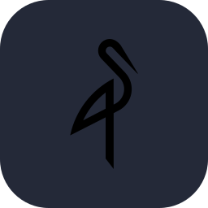
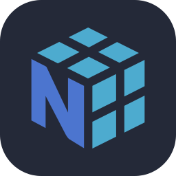

<!-- HERO SECTION -->
<div align="center">
  
</div>

<!-- DYNAMIC TAGLINE -->
<div align="center">
  
</div>

<br>

<!-- VISITOR COUNTER & SOCIAL PROOF -->
<div align="center">
  
  
  
  
</div>

<br>

<!-- PROFESSIONAL SUMMARY -->
<table>
<tr>
<td width="60%" valign="top">

### About Me

**Founder of [Chelaran](https://chelaran.ru)** — Full-cycle digital agency specializing in web development, Telegram bots, CRM systems, and business automation. From MVP to production in 2-4 weeks.

Backend developer with expertise in **Go** and **Python**, who has skills in frontend development, building scalable distributed systems and high-load applications. Experience integrating AI/ML models into production, creating microservices architectures, and optimizing system performance.

**Southern Federal University** • Software Engineering • 2024

</td>
<td width="40%" valign="top">

### Quick Facts

```yaml
location: Taganrog, Russia
role: Full-Stack Developer
focus: Go
agency: Chelaran Digital
experience: 3+ years
hackathons: 6 victories
philosophy: Clean Architecture
```

</td>
</tr>
</table>

<br>

<!-- WHAT I BUILD -->
<div align="center">
  
### 🛠️ What I Build

</div>

<table align="center">
<tr>
<td align="center" width="25%">

**Microservices**
<br><sub>Scalable distributed systems with clean architecture</sub>

</td>
<td align="center" width="25%">

**REST APIs**
<br><sub>High-performance backends with proper design</sub>

</td>
<td align="center" width="25%">

**AI Integration**
<br><sub>ML models in production environments</sub>

</td>
<td align="center" width="25%">

**Full-Stack Apps**
<br><sub>From database to pixel-perfect UI</sub>

</td>
</tr>
</table>

<br>

---

<!-- TECH STACK VISUALIZATION -->
<div align="center">
  <h2>Technology Stack</h2>
</div>

### Backend & Systems

<div align="center">

<table>
<tr>
<td align="center" width="110">

<br><b>Golang</b>
</td>
<td align="center" width="110">

<br><b>Python</b>
</td>
<td align="center" width="110">

<br><b>FastAPI</b>
</td>
<td align="center" width="110">

<br><b>PostgreSQL</b>
</td>
<td align="center" width="110">

<br><b>SQLite</b>
</td>
<td align="center" width="110">

<br><b>Redis</b>
</td>
<td align="center" width="110">

<br><b>MongoDB</b>
</td>
<td align="center" width="110">

<br><b>MySQL</b>
</td>
<td align="center" width="110">

<br><b>Kafka</b>
</td>
<td align="center" width="110">

<br><b>C++</b>
</td>
</tr>
</table>

</div>

### Frontend & UI

<div align="center">

<table>
<tr>
<td align="center" width="110">

<br><b>TypeScript</b>
</td>
<td align="center" width="110">

<br><b>React</b>
</td>
<td align="center" width="110">

<br><b>Next.js</b>
</td>
<td align="center" width="110">

<br><b>Bun</b>
</td>
<td align="center" width="110">

<br><b>Tailwind</b>
</td>
<td align="center" width="110">

<br><b>JavaScript</b>
</td>
<td align="center" width="110">

<br><b>HTML5</b>
</td>
<td align="center" width="110">

<br><b>CSS3</b>
</td>
</tr>
</table>

</div>

### Tools

<div align="center">

<table>
<tr>
<td align="center" width="110">

<br><b>Docker</b>
</td>
<td align="center" width="110">

<br><b>Git</b>
</td>
<td align="center" width="110">

<br><b>GitHub</b>
</td>
<td align="center" width="110">

<br><b>GitLab</b>
</td>
<td align="center" width="110">

<br><b>Nginx</b>
</td>
<td align="center" width="110">

<br><b>Linux</b>
</td>
<td align="center" width="110">

<br><b>Postman</b>
</td>
<td align="center" width="110">

<br><b>Minio</b>
</td>
<td align="center" width="110">

<br><b>Prometheus</b>
</td>
<td align="center" width="110">

<br><b>Grafana</b>
</td>
<td align="center" width="110">

<br><b>Caddy</b>
</td>
</tr>
</table>

</div>

### Data & ML

<div align="center">

<table>
<tr>
<td align="center" width="110">

<br><b>scikit-learn</b>
</td>
<td align="center" width="110">

<br><b>Jupyter</b>
</td>
<td align="center" width="110">

<br><b>pandas</b>
</td>
<td align="center" width="110">

<br><b>NumPy</b>
</td>
</tr>
</table>

</div>

<br>

---

<!-- EXPERIENCE SHOWCASE -->
<div align="center">
  <h2>Professional Experience</h2>
</div>

<table>
<tr><th>Role</th><th>Organization</th><th>Highlights</th></tr>
<tr>
<td><b>Founder & Lead Developer</b></td>
<td>🚀 Chelaran Digital</td>
<td>

• Full-cycle digital agency<br>
• Web apps, bots, integrations<br>
• 2-4 week delivery pipeline

</td>
</tr>
<tr>
<td><b>Backend Developer</b></td>
<td>💼 Freelance / Commercial</td>
<td>

• Microservices architecture<br>
• High-load systems (Go/Python)<br>
• AI/ML integrations in production

</td>
</tr>
<tr>
<td><b>6x Winner</b></td>
<td>🏆 Hackathons</td>
<td>

• Software & Hardware tracks<br>
• Rapid prototyping<br>
• Team leadership

</td>
</tr>
</table>

<br>

---

<!-- CURRENT FOCUS -->
<div align="center">
  <h2>Current Focus</h2>
  
  <table>
  <tr>
  <td align="center">
  
  </td>
  <td align="center">
  
  </td>
  <td align="center">
  
  </td>
  </tr>
  </table>
</div>

<br>

<!-- CORE SKILLS -->
<div align="center">

### 🎯 Core Competencies

`Microservices Architecture` • `REST API Design` • `Database Optimization` • `AI/ML Integration`  
`Clean Architecture` • `System Design` • `Production Deployment` • `CI/CD Pipelines`

</div>

<br>

---

<!-- DEV QUOTE -->
<div align="center">
  
</div>

<br>

<!-- CONNECT SECTION -->
<div align="center">
  <h2>Let's Connect</h2>
  
  <a href="https://t.me/Alwaysxdroll">
    
  </a>
  <a href="https://chelaran.ru">
    
  </a>
</div>

<br>

<!-- FOOTER -->
<div align="center">
  
</div>
